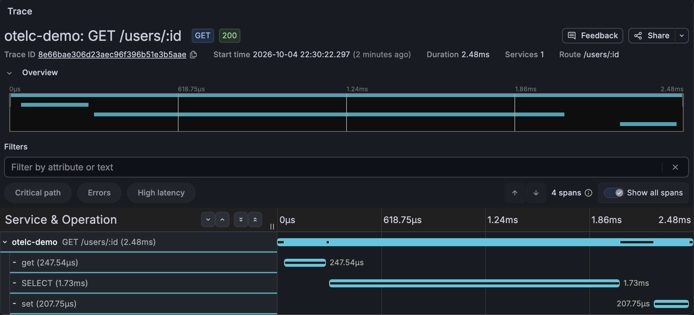

# otelc-trace-demo

OpenTelemetry 코드가 한 줄도 없는 Go API를 빌드 명령만 바꿔서 트레이스를 보내게 만드는 데모.
[OpenTelemetry Go 컴파일 타임 계측](https://opentelemetry.io/docs/zero-code/go/compile-time/)(`otelc`) v1.1.0으로 확인했다.

```bash
go build -o app .           # 평범한 서버
otelc go build -o app .     # 같은 코드, 트레이스를 보내는 서버
```

설명과 결과는 블로그 글 [otelc를 사용한 Go 트레이싱](https://corecode.pe.kr/normal/2026/10/04/go-otelc-zero-code-tracing/)에 정리했다.

## 예제 서비스

`main.go` 하나. Gin + SQLite(`modernc.org/sqlite`) + Redis(`go-redis/v9`).

| 엔드포인트 | 하는 일 |
|---|---|
| `GET /users/:id` | Redis 캐시 확인 → 없으면 SQLite 조회 → Redis에 저장 |
| `GET /report` | 일부러 느린 쿼리 (약 0.7초) |
| `GET /users-noctx/:id` | 요청 ctx를 넘기지 않는 코드 (`context.Background()`, `db.QueryRow`) |

## 1. Grafana로 보기 (Docker만 필요)

```bash
docker compose up -d --build
./load.sh 8080        # otelc로 빌드한 서버에 요청
./load.sh 8081        # go build로 빌드한 서버에 요청 (비교용)
```

[http://localhost:3000](http://localhost:3000) → Explore → 데이터 소스 Tempo → Query type TraceQL에 아래 쿼리를 넣고 Run query.

```
{resource.service.name="otelc-demo" && name=~"GET.*"}
```

목록에서 Trace ID를 누르면 요청 하나의 구간별 시간이 보인다.
`plain-demo`(8081)는 같은 코드지만 트레이스가 하나도 없다.



정리: `docker compose down`

## 2. 서버 없이 파일로만 남기기

Go 1.26 이상과 `otelc`가 필요하다.

```bash
go install go.opentelemetry.io/otelc/tool/cmd/otelc@v1.1.0
docker compose down   # 1번을 띄워 두었다면 8080 포트를 비운다
docker compose up -d redis
make console          # otelc로 빌드하고 span을 traces.jsonl에 기록
```

다른 터미널에서 `curl localhost:8080/users/3`을 몇 번 보내고, span이 파일에 쓰이도록 5초쯤 기다린 뒤 `Ctrl+C`로 끄고 확인한다.

```bash
jq -r 'select(.Name) | "\(.SpanContext.TraceID[0:8])  \(.Name)"' traces.jsonl
```

같은 trace ID를 가진 줄이 한 요청이다.

## 3. 실행 중 부하 비교

두 앱에 같은 CPU·메모리 한도(CPU 1개, 256MB)를 주고 `ab`로 같은 부하를 보낸다.

```bash
docker compose -f compose.yaml -f compose.bench.yaml up -d --build
./bench.sh 20000 10 7 /users/1    # 요청 수, 동시 접속, 반복 횟수, 경로
```

M1 맥 Docker Desktop, 중앙값 (`GET /users/1`, Redis 캐시 hit, 샘플링 없음)

| | `go build` | `otelc go build` |
|---|---|---|
| 처리량 | 12,694 req/s | 10,191 req/s |
| 평균 응답 시간 | 0.79ms | 0.98ms |
| p99 응답 시간 | 2ms | 4ms |
| 요청당 CPU 시간 | 45µs | 78µs |
| 메모리 | 9MB | 17MB |

`GET /report`(약 0.7초)는 736ms와 732ms로 차이가 없었다.

## 확인한 것 (macOS, M1, Go 1.26.0, otelc v1.1.0)

- `go.mod`·소스는 그대로. 계측 코드는 빌드 캐시(`.otelc-build/`) 안에서만 붙는다.
- 이 예제에서 계측된 패키지: `net/http`, `gin`, `database/sql`, `go-redis/v9`, `log`, `log/slog`, `runtime`
- 첫 빌드 약 49초(의존성 다운로드 포함), 이후 재빌드 약 10초 (`go build`는 1초 미만)
- 바이너리 크기 29MB → 58MB
- `/users-noctx/:id`처럼 ctx를 넘기지 않으면 Redis·DB span이 HTTP 요청과 다른 트레이스로 떨어진다.
- 서버 시작 때 실행한 쿼리(테이블 생성, 시드 INSERT)도 각각 따로 트레이스가 된다.
- Redis span의 `db.query.text`에 명령 인자가 그대로 남는다. (예: `set user:7 user-7 ex 30`)

## 라이선스

MIT
